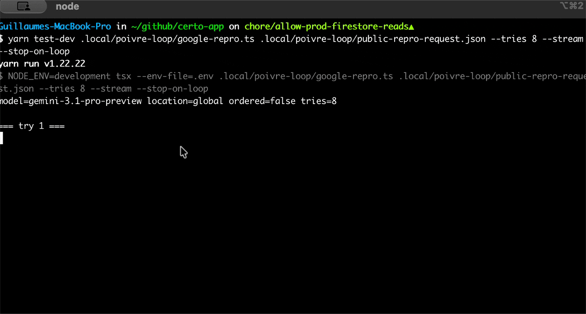

I asked Gemini for a percentage. It answered `23.5`, then kept typing zeros until the output budget ran out. **12,196 zeros** in one reply.



No error. No warning. Just a truncated JSON, and every field that should have come after that number was gone.

Here is what happened, why I think it happens, how to reproduce it in 2 minutes, and the one-line fix.

# The symptom

At [Certo](https://askcerto.com) we check the compliance of products and raw materials. The call is a boring one: read a couple of supplier documents, return the composition of a raw material as JSON. Structured output, a schema, temperature `0.1`, model `gemini-3.1-pro-preview` on Vertex AI.

Most of the time it works. Sometimes the reply looks like this:

```json
{
  "constituents": [
    {
      "name": "...",
      "cas": ["..."],
      "typicalPct": 23.500000000000000000000000000000000000000000000000000000000000000000000000000000000000000000000000000000000000000000000000000000000000000000000000
```

...and it goes on like that. In the 3 looped replies I found in production, the model wrote between **4,606 and 12,196 zeros** before hitting the output limit.

Three things make it nasty:

- **The value is right.** `23.5000…` is still 23.5. The model is not hallucinating a number, it is stuck after one.
- **The JSON is cut.** The reply stops at the token limit, mid-number. Nothing parses, and the rows and fields that should follow are lost.
- **You pay for it.** Every zero is billed output.

# Why it happens

The culprit is **the order of the keys**.

My schema declares the three percentage fields in the order a human reads them:

```
typicalPct → minPct → maxPct
```

All three are optional. And when you don't say otherwise, Vertex does not keep your order: it **sorts the optional properties alphabetically**. So the grammar that constrains the output expects:

```
maxPct → minPct → … → typicalPct
```

`typicalPct` is now the **last** key of the row.

In my test case, one document says `23.5 %` and the other says `15 à 35 %`. The right answer has all three: `typicalPct: 23.5`, `minPct: 15`, `maxPct: 35`.

Here is my reading of what goes wrong. The model starts with the value it read first, the way the schema and the prompt present it: `"typicalPct": 23.5`. The grammar lets it, since `maxPct` and `minPct` are optional and can be skipped. But skipping is final. Once `23.5` is written, the only things the grammar accepts are closing the row, or one more digit.

The model does not want to close the row: it still has a min and a max to write. With `--thoughts` on, the reasoning summary shows it intends to write all three. So it takes the only other exit, a digit. And the only digit that does not change the value is `0`. Then the same dead end again. And again. A few thousand times.

To be clear: the mechanism is my interpretation. The trigger is measured.

# The proof

I narrowed the production request down to something small enough to share:

- a **316-character** system prompt
- **two short documents**
- a schema with **9 keys**
- about **840 input tokens**

Results:

| Request | Looped |
|---|---|
| Minimal schema (9 keys), default key order | **3 of 5** |
| Same prompt, full production schema | **3 of 3** |
| Same request + `propertyOrdering` | **0 of 2** and **0 of 4** |

The file I share below is the second line: the short prompt with the real production schema, because that is the one that looped every time.

Small numbers, I know. Each try costs 1 to 5 cents and the whole investigation was 57 calls for about USD 2.47. But a bug that shows up more than half the time on an 840-token request is not a rare sampling accident.

# How to reproduce

You need a Google Cloud project with Vertex AI enabled, Node, and 2 minutes.

### 1. Get the two files

- [`google-repro.ts`](/assets/files/gemini-zero-loop/google-repro.ts) — the script, about one page, no dependency other than the SDK
- [`google-repro-request.json`](/assets/files/gemini-zero-loop/google-repro-request.json) — the exact request: system prompt, documents, schema

### 2. Install the SDK

```bash
npm install @google/genai
```

### 3. Log in

```bash
gcloud auth application-default login
export GOOGLE_CLOUD_PROJECT=your-project
```

### 4. Run it

```bash
npx tsx google-repro.ts google-repro-request.json --tries 8 --stream --stop-on-loop
```

`--stream` prints the reply as it arrives, so you watch the zeros pile up live. `--stop-on-loop` stops at the first looped try, so you don't pay for the next ones.

After each try the script prints one line of facts: `looped`, `finishReason`, token counts, and the longest run of a single character (a loop is 200 or more). Then the keys each row carries, and whether `maxPct: 35` made it.

### 5. Run the control

```bash
npx tsx google-repro.ts google-repro-request.json --tries 5 --ordered
```

Same request, with the declared key order sent as `propertyOrdering`. It should not loop.

### Other flags

- `--thoughts` — prints the model's reasoning summary for each try
- `--save <dir>` — writes every full reply to disk, with its response id
- `--model`, `--location`, `--max-tokens` — to try another model, region or output limit
- `--print-request` — prints the request JSON without calling the model (free)

# The fix

One line per object in your schema: tell Vertex the order you want.

```json
{
  "type": "object",
  "properties": {
    "typicalPct": { "type": "number", "nullable": true },
    "minPct": { "type": "number", "nullable": true },
    "maxPct": { "type": "number", "nullable": true }
  },
  "propertyOrdering": ["typicalPct", "minPct", "maxPct"]
}
```

If you generate your schema from Zod or Pydantic, `propertyOrdering` is not there unless you add it. Mine was not.

And because I don't trust a single fix on a probabilistic system, two guards on top:

- **Detect the loop.** A reply that ends on the output limit with a handful of fields and thousands of characters is not a long answer, it is a loop. Retry once.
- **Never accept a truncated reply as a short one.** If a table must be there, a missing table is an error, not an empty table.

# One more trap: which API are you really calling?

While capturing the actual HTTP body, I found something I did not expect.

I pass my schema as `responseSchema`. But because it is plain JSON Schema, the `@google/genai` SDK silently sends it as `generationConfig.responseJsonSchema`, and switches to the `v1beta1` endpoint to do so.

So what you write in your code is not what goes over the wire. It matters when you report the bug: paste that same schema in AI Studio and it does not even parse.

If you debug structured output, **print the real request**.

# What I take from it

- **Structured output is not a guarantee.** The grammar guarantees the *shape* of what is written. It does not guarantee the model ever finishes.
- **Key order is part of your prompt.** The model writes left to right. The order of the fields is the order of its reasoning. Don't let a default sort it for you.
- **A loop is silent.** No exception, a valid HTTP 200, a `finishReason` you have to look at. Check it.

I will report it to Google. I will update this post when I hear back.

### Resources

- [Structured output on Vertex AI](https://cloud.google.com/vertex-ai/generative-ai/docs/multimodal/control-generated-output)
- [Structured output in the Gemini API](https://ai.google.dev/gemini-api/docs/structured-output)
- [`@google/genai` SDK](https://github.com/googleapis/js-genai)
