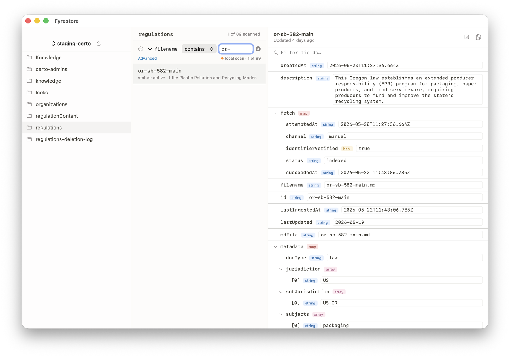

  

  <section class="fy-hero">
    

      

        
        Fyrestore
      

      <h1>Look at your Firestore data. Break nothing.</h1>
      

        A light, read-only macOS browser for Google Firestore.
        Sign in with your Google account and browse any project you have access to.
      

      

        <a href="https://github.com/guillim/fyrestore/releases" class="fy-btn" target="_blank" rel="noopener noreferrer">
          <svg width="16" height="16" viewBox="0 0 16 16" fill="none" aria-hidden="true"><path d="M8 1v9.5M8 10.5L4.5 7M8 10.5L11.5 7M3 13h10" stroke="currentColor" stroke-width="1.6" stroke-linecap="round" stroke-linejoin="round"/></svg>
          Download for macOS
        </a>
        <a href="https://github.com/guillim/fyrestore" class="fy-link" target="_blank" rel="noopener noreferrer">View on GitHub &rarr;</a>
      

      <ul class="fy-facts">
        <li>read-only</li>
        <li>free &amp; open source</li>
        <li>native Swift</li>
        <li>no Firebase SDK</li>
        <li>macOS 13+</li>
      </ul>
    

    

      
    

  </section>

  <section class="fy-section fy-section-panel">
    

      <h2>Three panes, nothing else</h2>
      
Projects and collections on the left, documents in the middle, fields on the right. It opens fast and stays out of the way.

      

        

          sign-in
          <h3>One button</h3>
          
Sign in with Google in your browser and you are back in the app. Tokens are cached in your macOS Keychain.

        

        

          inspector
          <h3>Typed fields</h3>
          
Every value shows its type. Maps and arrays fold and unfold, and you can filter fields by name.

        

        

          sub-collections
          <h3>Drill down</h3>
          
Sub-collections appear on the document. Click to go in, and use the breadcrumb to come back up.

        

        

          pagination
          <h3>100 at a time</h3>
          
The first 100 documents load right away. "Load more" fetches the next page when you want it.

        

        

          copy
          <h3>Copy as JSON</h3>
          
Copy any document as JSON, or just its reference path. Right-click for more.

        

        

          console
          <h3>Jump to Firebase</h3>
          
Need to change something? One click opens the same document in the Firebase Console.

        

      

    

  </section>

  <section class="fy-section">
    

      

        <h2>Find the document in one line</h2>
        
Type a filter as <em>field, operator, value</em>. No query builder, no index to set up for a quick look.

        

          Operators: <code>==</code> <code>!=</code> <code>&lt;</code> <code>&lt;=</code> <code>&gt;</code> <code>&gt;=</code> and <code>contains</code>, a case-insensitive substring match.
        

      

      <ul class="fy-filters" aria-label="Filter examples">
        <li>age &gt;= 18</li>
        <li>name == "alice"</li>
        <li>email contains "alice"</li>
      </ul>
    

  </section>

  <section class="fy-section">
    

      

        <h2>Read-only, on purpose</h2>
        

          The Firebase Console puts "delete" one click away from production data.
          Fyrestore has no write or delete call anywhere in its code, so there is nothing to click by mistake.
          Hand it to a teammate who only needs to look.
        

      

      <ul class="fy-list">
        <li>
          <strong>Your Google account, your permissions</strong>
          You see the projects your account can already see. A missing project means a missing IAM role, not a bug.
        </li>
        <li>
          <strong>Two viewer roles are enough</strong>
          <code>roles/datastore.viewer</code> on each project, and <code>roles/browser</code> so the app can list your projects.
        </li>
        <li>
          <strong>Small and readable</strong>
          A pure Swift package that talks to Google's APIs directly. Every line is on GitHub.
        </li>
      </ul>
    

  </section>

  <section class="fy-cta">
    <h2>Download it, sign in, browse</h2>
    
Free and open source. Or clone the repository and run <code style="font-family: var(--fy-mono); font-size: 0.9em;">swift run Fyrestore</code>.

    

      <a href="https://github.com/guillim/fyrestore/releases" class="fy-btn" target="_blank" rel="noopener noreferrer">Download for macOS</a>
      <a href="https://github.com/guillim/fyrestore" class="fy-link" target="_blank" rel="noopener noreferrer">Read the source</a>
    

    <ul class="fy-notes">
      <li>The app is not notarized by Apple yet: the first time, right-click it and choose Open.</li>
      <li>Google may show a "Google hasn't verified this app" screen at sign-in. Choose Advanced, then Continue.</li>
      <li>Requires macOS 13 or later.</li>
    </ul>
  </section>

