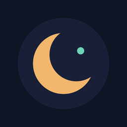

  

  <section class="nz-hero">
    

      

        

          
          NuzzleCam
        

        <h1>A baby monitor made of the iPhones <em>you already own</em>.</h1>
        

          One device stays in the baby's room, up to two others stay with the parents.
          Picture and sound go straight from one device to the other. No server, no relay, no account.
        

        

          <a href="https://github.com/guillim/babyphone" class="nz-btn" target="_blank" rel="noopener noreferrer">
            <svg width="18" height="18" viewBox="0 0 16 16" fill="currentColor" aria-hidden="true"><path d="M8 0C3.58 0 0 3.58 0 8c0 3.54 2.29 6.53 5.47 7.59.4.07.55-.17.55-.38 0-.19-.01-.82-.01-1.49-2.01.37-2.53-.49-2.69-.94-.09-.23-.48-.94-.82-1.13-.28-.15-.68-.52-.01-.53.63-.01 1.08.58 1.23.82.72 1.21 1.87.87 2.33.66.07-.52.28-.87.51-1.07-1.78-.2-3.64-.89-3.64-3.95 0-.87.31-1.59.82-2.15-.08-.2-.36-1.02.08-2.12 0 0 .67-.21 2.2.82.64-.18 1.32-.27 2-.27s1.36.09 2 .27c1.53-1.04 2.2-.82 2.2-.82.44 1.1.16 1.92.08 2.12.51.56.82 1.27.82 2.15 0 3.07-1.87 3.75-3.65 3.95.29.25.54.73.54 1.48 0 1.07-.01 1.93-.01 2.2 0 .21.15.46.55.38A8.01 8.01 0 0016 8c0-4.42-3.58-8-8-8z"/></svg>
            View the source on GitHub
          </a>
          <a href="#how" class="nz-link">How it works &darr;</a>
        

        <ul class="nz-facts">
          <li>Open source</li>
          <li>iPhone &amp; iPad, iOS 16+</li>
          <li>Works without internet at home</li>
          <li>English &amp; French</li>
        </ul>
      

      

        

          

            

              

              
Baby side

              
Monitoring

            

          

          

            

              

                Live
                02:14
              

              

              

                🎙️
                💡
                🎵
                🌊
              

            

          

        

        
Illustration, not a screenshot.

      

    

  </section>

  <section class="nz-section nz-section-alt" id="how">
    

      <h2>Set up in a minute</h2>
      
That old iPhone in the drawer is a better camera than most baby monitors. Put it to work.

      <ol class="nz-steps">
        <li>
          <h3>Pick a side</h3>
          
On each device, choose "Baby side" or "Parent side". Any iPhone or iPad can play either role.

        </li>
        <li>
          <h3>Pair once, side by side</h3>
          
The parent device scans the QR code shown on the baby device, or you type its six digits. No shared Wi-Fi needed to pair.

        </li>
        <li>
          <h3>Start monitoring</h3>
          
Tap start on the baby device and leave it plugged in. The parent device connects by itself, and reconnects by itself.

        </li>
      </ol>
    

  </section>

  <section class="nz-section">
    

      <h2>Everything a night needs</h2>
      
Built by a parent, for the 3 a.m. version of yourself.

      

        

          👶
          <h3>Cry detection</h3>
          
Runs on the baby device with the sound classifier that ships in iOS. Choose to be alerted for any noise, or for crying only.

        

        

          🔔
          <h3>Alerts you will hear</h3>
          
Noise, unplugged charger, low battery, lost link. Alarms play through the app's own audio, so they ring on silent and in a Focus mode.

        

        

          👫
          <h3>Two parents</h3>
          
Each parent pairs separately, zooms independently and can switch to audio only. Either one can be removed at any time.

        

        

          🌙
          <h3>Night light, lullaby, white noise</h3>
          
Triggered from the parent's phone. The lullaby and white noise are synthesised by the app, with a 15, 30 or 60 minute timer.

        

        

          🔦
          <h3>Low light &amp; zoom</h3>
          
Low-light mode slows the camera for longer exposures in a dark room. Pinch up to 4× on the parent's screen.

        

        

          🎙️
          <h3>Talk back</h3>
          
Hold the talk button to soothe from the next room. The microphone opens only while you hold it.

        

      

    

  </section>

  <section class="nz-section nz-section-alt">
    

      

        <h2>Nobody else is in the room</h2>
        

          Most camera apps send your nursery through somebody's cloud. NuzzleCam has no cloud to send it to.
          Video and audio are encrypted between your two devices and travel directly from one to the other.
        

      

      <ul class="nz-list">
        <li>
          <strong>At home: Wi-Fi only</strong>
          The devices find each other with Bonjour. This needs neither internet nor iCloud.
        </li>
        <li>
          <strong>Away from home: a direct link</strong>
          The devices leave each other one small encrypted note in iCloud with their current addresses, then connect directly. Nothing else goes through iCloud.
        </li>
        <li>
          <strong>A key that never travels</strong>
          Pairing runs a password-authenticated key exchange. The resulting 256-bit key lives in the Keychain, and only the paired device gets through.
        </li>
        <li>
          <strong>No account, no tracking</strong>
          Nothing to sign up for, and every line is on GitHub for you to read.
        </li>
      </ul>
    

    

      

        <strong>The honest part.</strong> No relay means some networks cannot be crossed.
        When no direct path exists, the parent device says so and falls back to alerts only, read through iCloud about every 20 seconds: no picture, no sound.
        NuzzleCam is a young project, and it does not replace checking on your child.
      

    

  </section>

  <section class="nz-cta">
    <h2>Build it tonight</h2>
    
NuzzleCam is not on the App Store yet. The whole app is open source: clone it, open it in Xcode, and run it on your own devices.

    

      <a href="https://github.com/guillim/babyphone" class="nz-btn" target="_blank" rel="noopener noreferrer">Get the code on GitHub</a>
      <a href="https://github.com/guillim/babyphone/issues" class="nz-link" target="_blank" rel="noopener noreferrer">Report an issue</a>
    

    
Requires Xcode 16+, two iPhones or iPads on iOS 16+, and an Apple Developer account.

  </section>

